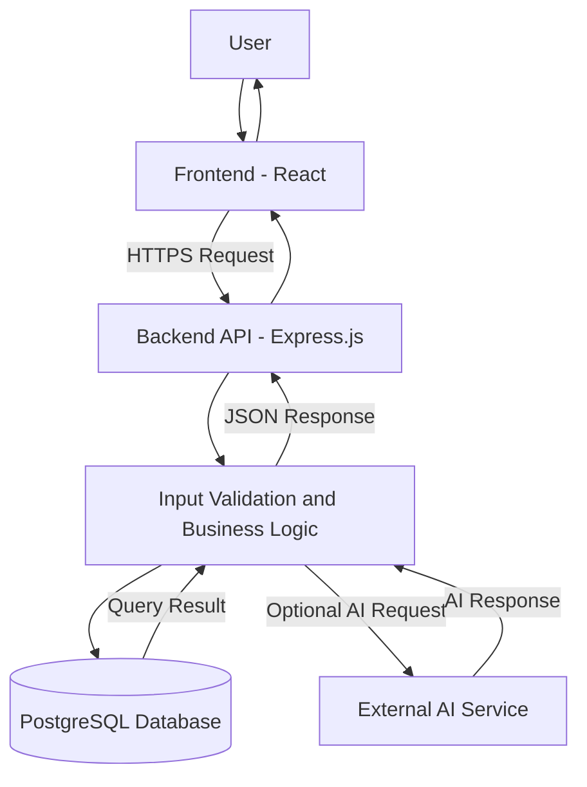

# System Architecture Diagram

## 1. High-Level Architecture

The following diagram represents a typical full-stack web application with an optional AI service.

## 2. Component Responsibilities

1. **User:** Provides input and views the results.
2. **Frontend:** Displays the interface and sends requests to the backend.
3. **Backend API:** Receives requests and coordinates application operations.
4. **Input validation and business logic:** Checks user input and applies application rules.
5. **Database:** Stores and retrieves persistent information.
6. **AI service:** Optionally performs tasks such as text summarization, classification, or question answering.
7. **JSON response:** Carries the result from the backend to the frontend.

## 3. Architecture Notes

- The frontend communicates with the backend using HTTP/HTTPS.
- The backend handles database access and protects database credentials.
- The AI service is optional and is called only when the feature requires it.
- Sensitive API keys should remain on the backend, not in frontend code.
- The backend should handle validation failures, database errors, and external service timeouts.
- The architecture can be extended with caching, load balancing, and additional server instances as requirements grow.

## 4. Conclusion

This architecture separates presentation, business logic, data storage, and external integrations. This separation makes the application easier to maintain and allows individual components to be improved when necessary.
