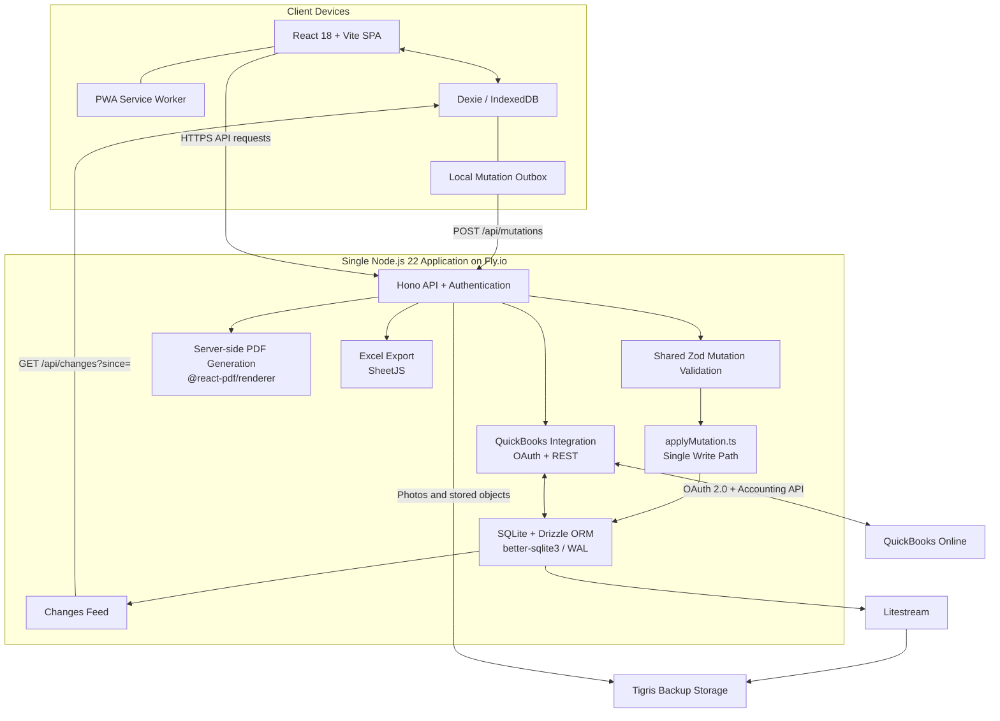

# Legacy OFS — Proposed System Architecture

## Architecture Diagram

## Component Responsibilities

| Component | Responsibility |
|---|---|
| React, Vite, Tailwind CSS, shadcn/ui | User interface for Field Workers and Admins |
| PWA service worker | Caches the application shell and supports installation |
| Dexie / IndexedDB | Local data mirror and offline mutation outbox |
| Zod schemas | Shared validation rules for client mutations and server ingestion |
| Hono | API endpoints, authentication middleware, and request handling |
| `applyMutation.ts` | The single server-side write path for ticket-related mutations |
| SQLite, Drizzle ORM, better-sqlite3 | Persistent relational data and database migrations |
| Changes feed | Returns server-side changes for client synchronization |
| QuickBooks integration | Customer/item synchronization and invoice creation |
| PDF generation | Produces branded ticket and inspection PDFs |
| SheetJS | Generates Excel exports |
| Litestream and Tigris | Database backup replication and object storage |

