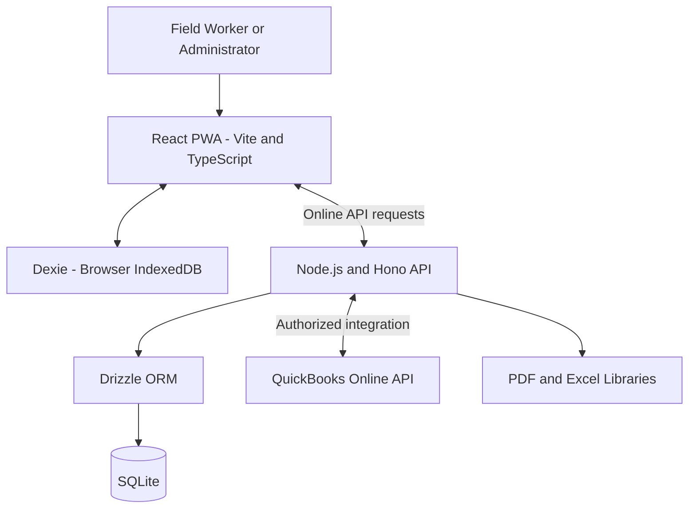

# Legacy OFS — Initial Architecture, Risks, and Testing

## 1. Proposed High-Level Architecture

The following is a preliminary component map based on the technology stack listed in the project brief. It must be checked against the official architecture document before implementation.

## 2. Component Responsibilities

- **React, Vite, TypeScript, and Tailwind CSS:** Build the mobile-friendly user interface.
- **PWA support:** Provide installable application behavior and support the intended offline experience.
- **Dexie:** Manage browser-side IndexedDB storage for local records and pending operations.
- **Node.js and Hono:** Handle backend requests, validation, authorization, business rules, and integrations.
- **SQLite and Drizzle ORM:** Provide the prescribed database and data-access layer, subject to confirmation of their deployment arrangement.
- **QuickBooks Online APIs:** Support customer/item synchronization and invoice operations.
- **PDF and Excel libraries:** Produce ticket documents, inspection reports, and spreadsheet exports.

The exact runtime boundaries, authentication mechanism, file storage, and database synchronization strategy must be confirmed from the architecture document.

## 3. Example Data Flow

1. A field worker enters ticket information in the PWA.
2. The application saves the ticket locally so the worker can continue offline.
3. Pending operations are retained for synchronization.
4. When connectivity is available, the client sends authorized requests to the backend.
5. The backend validates the user, permissions, ticket data, and requested operation.
6. The prescribed database layer persists the accepted changes.
7. The client receives a response and updates the local synchronization state.
8. An administrator reviews the ticket and performs an allowed status transition.
9. The invoicing workflow sends approved ticket data to QuickBooks Online.
10. The application records the invoice outcome and prevents duplicate invoice creation.

The final flow must account for retries, conflicts, rejected submissions, and interrupted network requests.

## 4. Major Technical Risks

| Risk | Impact | Initial mitigation |
|---|---|---|
| Offline synchronization conflicts | Lost or inconsistent ticket changes | Define reconciliation rules, versioning, retries, and idempotency |
| Shared accounts and device limits | Unauthorized access or incorrect device tracking | Enforce permissions and active-device limits on the server |
| Invalid ticket status transitions | Incorrect approvals or invoicing | Define permitted transitions and validate them on the backend |
| QuickBooks API failures | Missing or duplicate invoices | Track external IDs, use safe retries, and reconcile uncertain outcomes |
| Large inspection photos | Slow synchronization or failed reports | Define size limits and reliable file handling |
| Unclear database deployment | Incorrect persistence or sync design | Verify the official architecture before implementing storage |
| Missing client configurations | Incorrect forms and validation | Obtain approved templates and inspection configurations |
| Scope growth | Delayed delivery | Track approved requirements and obtain approval for changes |

## 5. Testing Strategy

### Unit Testing
Test individual validation functions, business rules, calculations, status transitions, device-limit logic, and synchronization helpers.

### Integration Testing
Test backend endpoints, database persistence, authorization, synchronization operations, PDF generation, and QuickBooks integration behavior.

### End-to-End Testing
Test complete user journeys, including login, ticket creation, submission, administrator approval, inspection completion, and invoicing.

### Offline and Mobile Testing
- Create and edit tickets with connectivity disabled.
- Close and reopen the application while offline.
- Reconnect and verify that pending changes synchronize.
- Simulate failed requests, repeated submissions, and conflicting edits.
- Verify pending and failed status indicators.
- Test the application on supported mobile browsers and screen sizes.

### Security Testing
Test role restrictions, unauthorized requests, server-side validation, secret handling, device revocation, and access to protected records.

### Reporting Testing
Verify PDF content, inspection photos, branding, spreadsheet columns, filters, and exported values against the source records.

## 6. Preliminary Acceptance Criteria

- Users can access only the functions permitted by their roles.
- The five-active-device limit is enforced and revoked devices are handled correctly.
- Required ticket fields and configured templates behave as specified.
- Only permitted ticket status transitions are accepted.
- Offline ticket changes persist and synchronize after reconnection.
- Synchronization failures are visible and can be handled without duplicating accepted operations.
- Inspection forms enforce required questions and preserve submitted answers and photos.
- QuickBooks customer/item synchronization and invoicing handle failures without creating duplicate invoices.
- Ticket PDFs, inspection PDFs, and filtered Excel exports contain the required data.
- Unit, integration, end-to-end, and mobile/offline tests meet the agreed release criteria.
- Setup, deployment, and implementation documentation is complete.

Exact coverage thresholds, supported devices, performance targets, and release gates must be confirmed with the mentor.

## 7. Open Questions

1. What are the exact runtime and persistence boundaries for SQLite and Dexie?
2. What authentication and session strategy is prescribed?
3. What rules resolve concurrent offline edits?
4. What should happen when an offline submission is rejected by the server?
5. Which ticket templates, inspection configurations, and branding assets are approved?
6. Are QuickBooks sandbox credentials and application registration details available?
7. Which PDF and Excel libraries and versions are specified?
8. What deployment platform, deadline, and review milestones are required?

## 8. Conclusion

The proposed architecture separates the user interface, local offline storage, backend business logic, persistent database, external accounting integration, and reporting. The design, risks, and acceptance criteria must be reconciled with the supplied architecture and handoff documents before full implementation.

